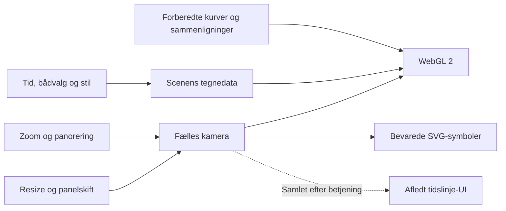

# GPU-first: arkitekturreview og gennemførelsesplan

11. november 2026. Udgangspunkt: `7d78e91`.

## Vurdering

Faste replaydata og alle tre sammenligningsgrundlag forberedes allerede før
betjening. Det er det rigtige fundament. Problemet ligger mellem kamerainput,
rendering og brugerflade:

| Område | Problem | Beslutning |
| --- | --- | --- |
| Spor | Rastercache i skærmopløsning kræver nye atlas ved zoom og en særskilt komposition af farve og tidsdybde. | Fjern rastercache, atlas og deres opbygningspolitik. Tegn de forberedte kubiske kurver direkte med WebGL 2. |
| Geometri | Alle intervaller koster 32 underopdelinger plus begge endekapper, også næsten rette kurver og interne punkter. | Vælg underopdeling ud fra en forberedt krumningsgrænse og en fast fejlgrænse i skærmpixels. Tegn kun virkelige sporender og tidsvinduets klippede ender som kapper. |
| Kamera | Flere lag læser SVG-matricer og layout gentagne gange og væver det sammen med DOM-skrivning. | Én eksplicit kameramodel med en layoutmåling ved størrelse-/positionsændring. Alle lag bruger samme projektion. |
| Input og tid | Hver wheel-/pointerhændelse undersøger hele feltets passageperioder og kan flytte tidspunktet. | Kamerainput ændrer kun kameraet. Bevar tidspunktet. Tidslinjens afledte synlighedsindeks opdateres samlet uden at flytte scenen. |
| SVG-komposition | Markører, legendens gradient og geografisk faste lag bliver oprettet igen under almindelig betjening. | Bevar elementer og ret kun de attributter, hvis input faktisk ændres. SVG for ikoner og annotationer forbliver en del af den nominelle komposition. |
| Bådliste | Kameraopdatering genberegner fart og sorterer listen, selv om listens indhold ikke afhænger af kameraet. | Adskil layout fra indhold. Opdater indhold ved tid-/filterændring. |
| Fejl | GPU-fejl skal fortsat blokere visningen tydeligt. | Bevar én nominel renderingsvej og genskab den samme vej efter konteksttab. |

Der indføres ingen automatisk alternativ renderer. CPU'en håndterer input,
tilstand, brugerflade og opslag i forberedte tidsindekser. GPU'en projicerer,
evaluerer og rasteriserer kurverne, klipper tidsvinduer og afgør farve og
passagerækkefølge. Kameraændringer uploader ingen sporgeometri eller profiler.

## Gennemførelse

1. Mål eksisterende zoom og afspilning med hele feltet i headless Firefox.
2. Fjern rastercachen og dens produktions-/testkoblinger. Indfør direkte,
   fejlbegrænset kurvetegning med særskilte kapper og uændrede tids-/farveregler.
3. Saml kamera og layout. Adskil kamera-, scene- og layoutopdateringer, og bevar
   tiden ved zoom/panorering. Bevar tidslinjens geografiske filtrering som afledt UI.
4. Bevar SVG-elementer og adskil bådlistens indhold fra kameraets layout.
5. Opdater relevante tests og dokumentation. Mål igen og kontroller især
   kurvepræcision, stregbredde, tidsdybde, reference-/handicapvisning, kameraankring,
   lag, eventscener og tydelig fejl ved tab af WebGL.

## Acceptkriterier

- Ingen sporatlas, rastercache, cacheopvarmning eller faste GPU-datauploads under betjening.
- Zoom og panorering flytter ikke tiden eller genopbygger bådlisten.
- Ét fælles kamera for WebGL og SVG, også ved letterboxing, panelændring og resize.
- Alle kildepunkter, huller, kubiske kurver, konstante skærmbredder og nyere passagers tidsdybde bevares.
- Underopdeling styres af en dokumenteret skærmfejl, aldrig en ubegrundet reduktion af kvalitet.
- Relevante tests og før/efter-målinger gennemføres skjult i Firefox på PC.

## Gennemført

Alle fem trin er gennemført. Den tidligere cacheimplementering og dens tests er
fjernet. Den direkte renderer har én procedurel krops-/kapperutine, statiske
kurve-, kappe- og sammenligningsteksturer samt bevarede kommandooplysninger for
scenens tidsvindue. Rene kameraændringer genbruger disse oplysninger uden nye
opslag i tidsindekser eller beregning af handicapvinduer.

Centerlinjens fejlbudget er 0,125 CSS-pixel. Den maksimale anden afledte af hver
båds Float32-kubikker forberedes én gang. Med kameraets konservative skærmskala
`s` vælges `N = max(1, ceil(sqrt(M*s/(8*error))))`. Testen efterprøver 2.828
midtpunkter ned til kortbredden 0,05 og målte højst 0,0762 CSS-pixel afvigelse.
Pixeltests mod 128 underopdelinger giver ingen manglende/ekstra dækningsområder
eller forkerte stabile interiørpixels i ti kombinationer af zoom og farvevalg.
Fejlbudgettet gælder kurvens centerlinje; rasterkanter kontrolleres særskilt.

Kameraet afledes af SVG's viewBox og én gemt layoutmåling. Shaderne og SVG bruger
samme matrix. Bådmarkører, hullernes SVG-stier, navne, legendens gradient,
målestok og geografisk faste figurer genbruges. Et lukket bådpanel beregner ingen
fartværdier. En eksisterende Firefox-fejl ved meget lille invers skalering blev
også fjernet: bådens interaktive cirkel ligger nu i kortkoordinater, mens de
visuelle symboler skaleres inde i markøren. Klik og tastatur bruger stadig den
samme nominelle SVG-markør uden en ekstra hit-testimplementering.

Tidslinjens viewportindeks samles med en 150 ms opgave efter sidste
kameraændring. Den opdaterer kun sliderens afledte UI. Ved faktisk betjening af
slider/step/Afspil synkroniseres indekset først. En startet afspilning fastholder
sine oprindelige passageperioder, så et nyt udsnit ikke flytter tiden eller
stopper afspilningen. Nye afspilninger bruger det nye udsnit.

## Målinger og validering

Lokal headless Firefox 137 på Windows, ANGLE/Intel HD Graphics, 106 både,
1500 × 1000 CSS-pixel. Samme 20 wheel-trin som den forrige zoommåling; vind og
radar er slået fra. Det nye kamera bevarer tidspunktet, hvor den tidligere
implementering ændrede tidspunktet i seks trin. Tallene sammenligner derfor det
samme inputforløb og kortudsnit, men den nye kontrakt undgår de gamle tidsspring.

| Gennemsnit pr. zoomtrin | Før (`7d78e91`) | Direkte GPU |
| --- | ---: | ---: |
| Input på CPU | 6,35 ms | 0,45 ms |
| Tegnekald på CPU inkl. aflevering | 18,05 ms | 5,20 ms |
| Efterfølgende GPU/driver-ventetid | 28,20 ms | 24,95 ms |

GPU-ventetid måles med `gl.finish()` udelukkende i profilværktøjet. Den er hverken
ren shader-eksekvering eller en måling af skærmens præsentation. 12 zoomtrin
omkring referencebåden er desuden kontrolleret med layoutmålinger og GPU-uploads
sat til at fejle: nul kald, nul scene-/listeopdateringer og nul beregninger af
sporenes tidsvinduer. Bagefter foretages præcis én slideropdatering uden scenetegning.

Afspilning er målt uden funktionsinstrumentering: to sekunders opvarmning og tre
sekunders måling pr. scenarie, 100× hastighed og to timers spor. 50 ms timeren
er uændret, så scenetegningens gennemsnitlige interval er fortsat cirka 60–62 ms.

| Scenarie | rAF-interval før | rAF-interval efter |
| --- | ---: | ---: |
| Uden vejr | 17,96 ms | 16,76 ms |
| Med vind | 18,06 ms | 16,67 ms |
| Referencefølgning | 25,86 ms | 17,65 ms |

Den direkte renderer afleverer cirka 475.716 vertices og 212 draw-kald pr.
afspilningsframe med hele feltet. Den uploader ingen spor-/kompositionsdata.
Målingerne er korte lokale kontroller; de er ingen garanti for andre GPU'er
eller en forøgelse af den valgte afspilningsfrekvens.

Følgende er kontrolleret skjult i Firefox på PC:

- Kurvefejl, 128-delt pixelreference i alle fem farvevalg, 4.560 tætte
  samlingsprøver og 20 kappeprøver.
- Tidsdybde ved modsatrettede krydsninger, selvkrydsninger, huller, omvendt søgning
  og millisekunders forskel sent i rejsen.
- 26.740 krops-/kappedraws med faste bindinger og nul datauploads samt
  20 farveprøver ved teksturrækkegrænser; desuden skalaoverflow og handicap.
- Faktisk stregbredde gennem 40× zoom, alle båddimensioner, minimumsstørrelse,
  nærzoom, klik og tastatur.
- Zoomankring, bevaret tid, coalescing, genbrug af DOM, paneler og resize.
- Alle 60 gemte eventscener i tre fuldskærmstilstande ved HiDPI: 1.850
  pixelprøver på faktiske spor og fælles clipping.
- Afspilning, bevaret tidsforløb efter panorering til et udsnit uden både,
  eventnavigation, referencefølgning, medier ved ankomst og bevarede indstillinger.
- Tydelig fejl ved manglende WebGL/konteksttab og gendannelse af samme renderer.
- 7.286 differentialprøver af det bevarede geografiske tidsindeks og den faste
  handicapmatematik uden browser.

## Grænser

SVG-symbolers størrelse, vindpilenes prøvepunkter, TSS-pile og fartmærkers placering
ved skærmens kanter kræver fortsat kameraafhængig CPU-logik. Den er en eksplicit del
af kompositionen. Baggrund og spor rasteriseres af WebGL 2. Der er to WebGL-flader
for at bevare den eksisterende lagfølge med SVG imellem dem; de deler kameramodel.
En enkelt flade ville kræve en ændring af kompositionen og er ikke nødvendig for
at fjerne de målte flaskehalse. Afspilningens valgte cadence på 50 ms er bevaret.
